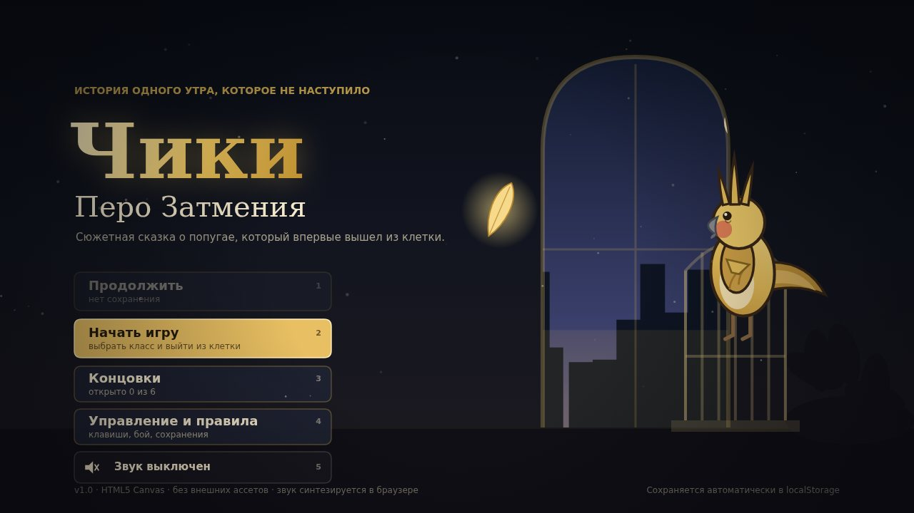
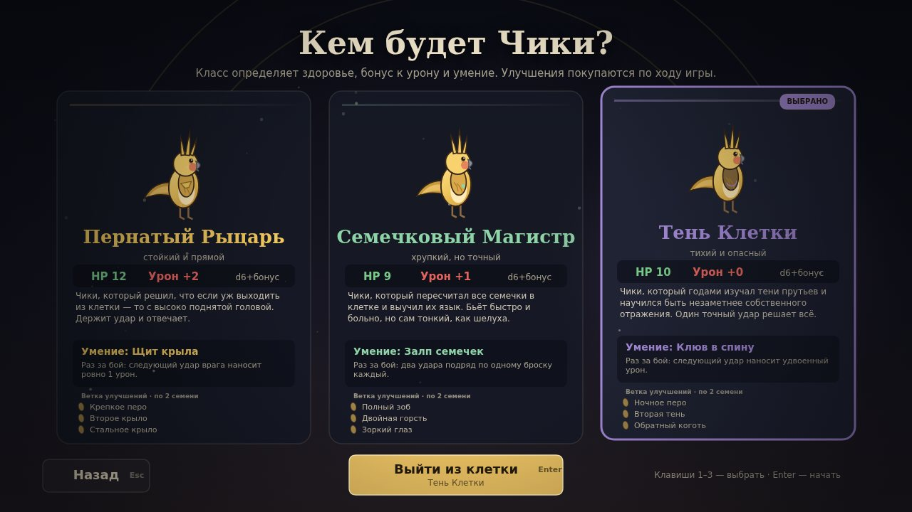
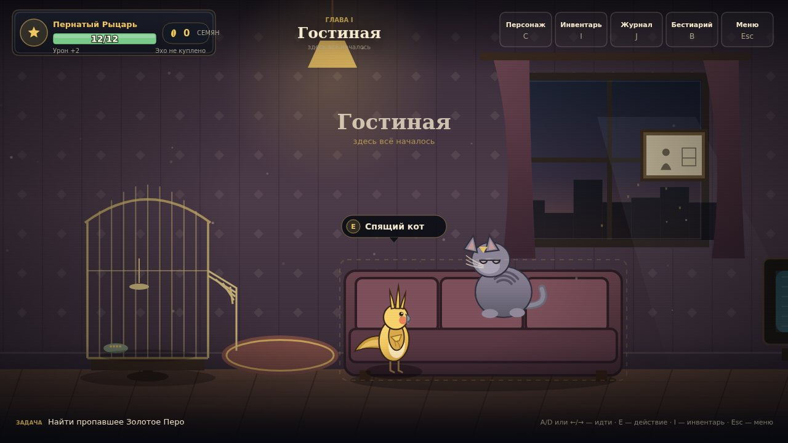
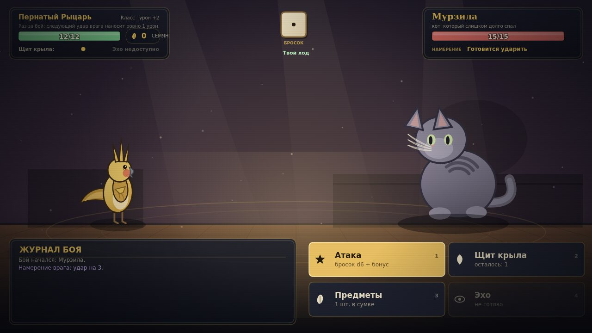
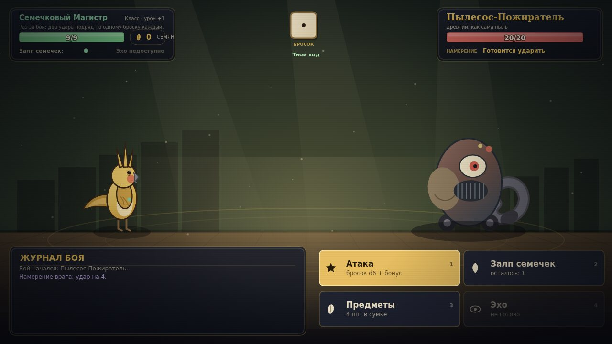
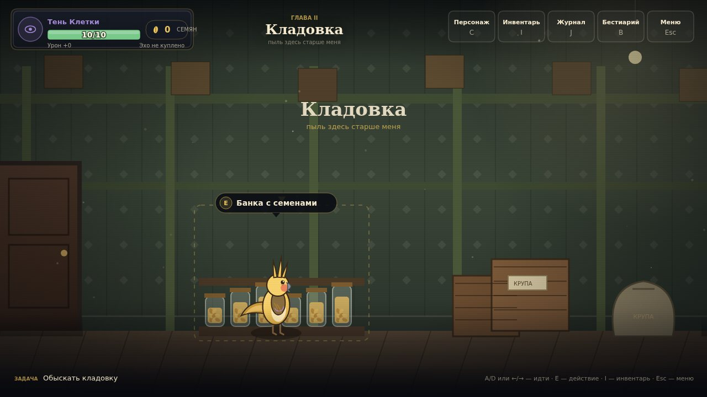
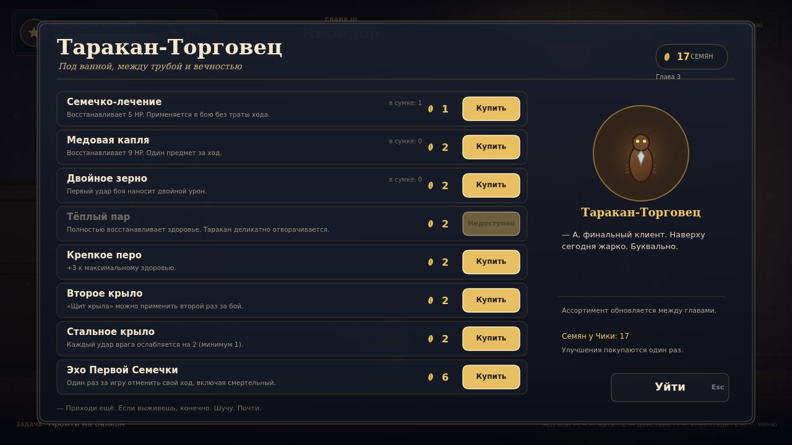
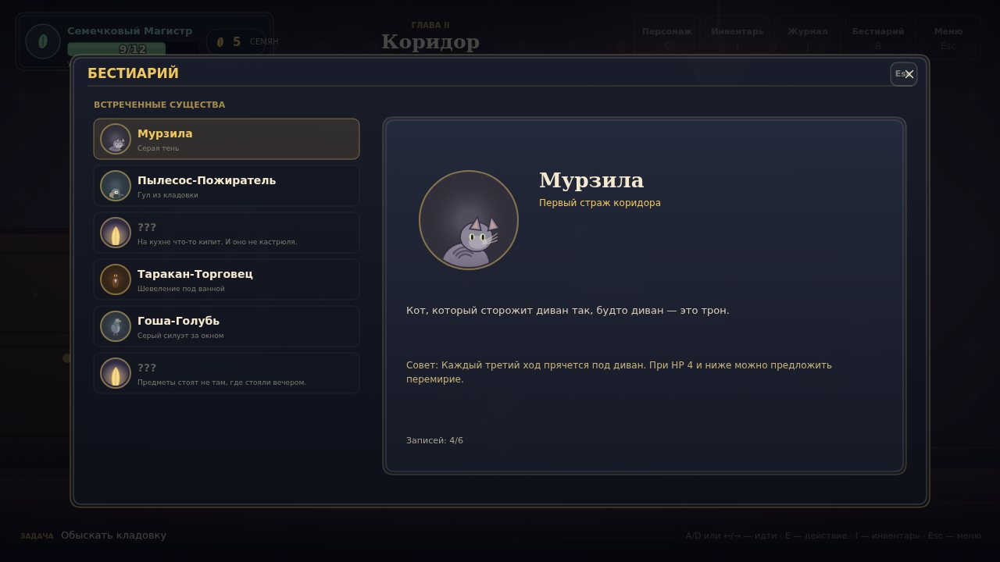
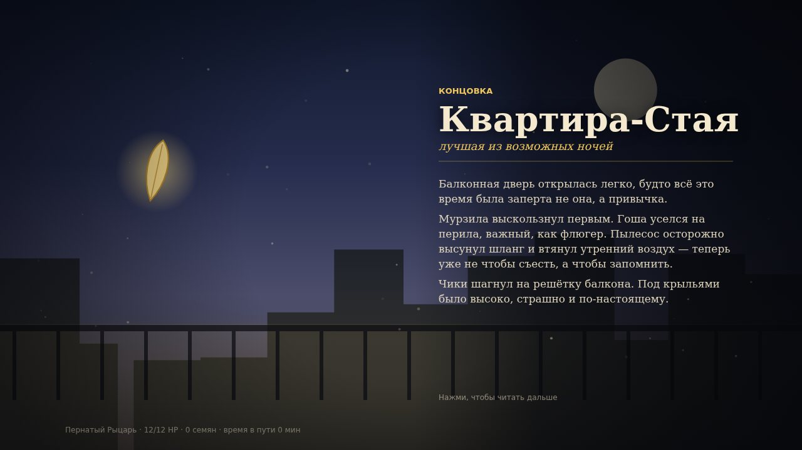

# Чики: Перо Затмения

Сюжетная 2D-игра на HTML5 Canvas: жёлтый корелла Чики просыпается в квартире, где
не наступило утро. Золотое Перо, которое держало балконную дверь, исчезло, квартира
выросла и зажила своей жизнью, а по комнатам ходят те, кто обычно молчит.

Три главы, три босса, два торговца, шесть концовок. Всё нарисовано кодом: ни одного
внешнего изображения или звукового файла, только Canvas и Web Audio.



## Быстрый старт

Нужен только Node.js (проверено на 22) — сборка не требуется, зависимостей нет.

```bash
npm start          # http://localhost:3000
```

Любой другой статический сервер тоже подойдёт (модули ES требуют http, а не file://):

```bash
python3 -m http.server 3000
```

## Управление

| Действие | Клавиши |
| --- | --- |
| Идти | `A` / `D`, `←` / `→` |
| Осмотреть, поговорить, взять | `E` или `Пробел` |
| Подойти к предмету | клик по предмету |
| Инвентарь · Персонаж · Журнал · Бестиарий · Меню | `I` · `C` · `J` · `B` · `Esc` |
| Бой: атака · умение · предметы · эхо | `1` · `2` · `3` · `4` |
| Диалог | `Пробел` / клик, варианты — `1`–`4` |

На телефоне всё то же самое делается касаниями — см. следующий раздел.

## Игра с телефона

Игра рассчитана на телефон: холст занимает весь экран, сверху — крупные плитки
«Герой · Сумка · Журнал · Звери · Меню», снизу — круглые кнопки «идти влево»,
«идти вправо» и «действие». Предметы, двери и варианты ответов нажимаются пальцем;
в бою — те же четыре больших кнопки (`1`–`4` работают для клавиатуры).

- Открывай игру по ссылке превью в горизонтальной ориентации: сцена 16:9, в портрете
  она мелкая. Если телефон повёрнут вертикально, сверху на секунду появляется подсказка.
- Первое касание разворачивает игру на весь экран и разблокирует звук (так требуют
  браузеры). Если полноэкранный режим не включился, есть кнопка в меню паузы:
  «Развернуть на весь экран».
- Сохранение живёт в памяти браузера: не открывай игру в приватном окне, иначе
  прогресс не сохранится.

## Что в игре

**Классы.** Пернатый Рыцарь (12 HP, +2 к урону, «Щит крыла» — удар врага не больше 1),
Семечковый Магистр (9 HP, +1, «Залп семечек» — два удара), Тень Клетки (10 HP, +0,
«Клюв в спину» — удвоенный удар, не тратит ход). Ветка улучшений у каждого своя.

**Бой.** Бросок d6 + бонус класса, шестёрка — крит. Один предмет за ход, ульта один раз
за прохождение. У каждого босса своя механика:

- Мурзила (15 HP, удар 3) — каждый третий ход прячется под диван;
- Пылесос-Пожиратель (20 HP, удар 4) — на слабых бросках (1–2) втягивает Чики и
  отнимает ход; в мешке лежит запасной ключ от балкона;
- Хозяин Макарон (28 HP, удар 5) — один раз предлагает макароны (+5 HP за два
  пропущенных хода), в конце боя распаляется и бьёт сильнее.

Мирный исход возможен, когда у врага мало HP: он даёт больше Семян Силы, доброту и
союзника.

**Экономика.** Семена Силы падают с боссов (3 за победу, 4 за перемирие), лежат в
тайниках и продаются за… нет, покупаются у торговцев. За 2 семени — улучшение класса,
за 6 — «Эхо Первой Семечки»: отмена собственного хода, включая смертельный.

**Торговцы.** Таракан под ванной (расходники и улучшения) и Гоша-Голубь на подоконнике
(редкие товары, союзник, подсказка о финале). Ассортимент обновляется между главами.

**Исследование.** Восемь комнат с тайниками, записками и необязательными находками.
Журнал ведёт главную задачу и пять попутных дел, бестиарий заполняется по мере встреч.

**Концовки.** Их шесть, и они считаются по накопленному: доброта, жадность, число
союзников. Последний выбор на балконе задаёт направление, но не решает исход в одиночку:

| Концовка | Как получить |
| --- | --- |
| Квартира-Стая | уйти, накопив доброту и союзников |
| Настоящее Утро | уйти, никого не бросив |
| Солнце в Клетке | уйти, ни разу не выбрав другого |
| Тихий Дом | остаться, не потеряв себя |
| Перо Затмения | забрать перо, когда жадность перевесила |
| Хранитель Квартиры | забрать перо, чтобы держать дверь открытой |

Сохранение пишется в `localStorage` при входе в комнату, покупках, после боя и по
команде из меню. «Продолжить» на главном экране поднимает последнее сохранение.

## Структура проекта

```
index.html, styles.css       — страница и адаптивная рамка холста
server.mjs                   — статический сервер без зависимостей
src/main.js                  — запуск игры, разблокировка звука, фатальные ошибки
src/core/                    — ввод, звук (Web Audio), сохранения, утилиты
src/data/                    — классы, предметы, враги, комнаты, диалоги, магазины
src/game/                    — состояние, боевая модель, концовки, контроллер игры
src/render/                  — палитра, спрайты, комнаты, эффекты
src/ui/                      — виджеты, HUD, панели
src/scenes/                  — меню, выбор класса, исследование, диалоги, бой, магазин, финал
tests/                       — логика, headless-отрисовка, сквозные прохождения
docs/PLAN.md                 — исходный план: схемы данных и формулы
```

Боевая модель (`src/game/combat.js`) не знает о canvas: её можно прогонять в Node,
чем и пользуются тесты баланса.

## Тесты

```bash
npm test
```

- `tests/logic.test.mjs` — формулы боя, механики боссов, экономика, концовки,
  согласованность данных (все диалоги, комнаты, товары и ссылки существуют);
  80 симуляций на каждую пару «класс × босс» проверяют, что бои завершаются и
  выигрываются при разумной подготовке.
- `tests/headless.mjs` — вся игра прогоняется в Node с заглушкой canvas: меню, выбор
  класса, все комнаты, диалоги, бои, магазины, панели, шесть концовок, сохранение.
- `tests/playthrough.mjs` — сквозное прохождение тремя классами в двух стилях игры:
  силой (все боссы убиты) и миром (перемирия, добрые решения). Проверяет, что нет
  тупиков и что концовка соответствует накопленным решениям.

## Скриншоты

| | |
| --- | --- |
|  |  |
|  |  |
|  |  |
|  |  |

## Заметки о реализации

- Разрешение сцены — 1280×720, холст масштабируется под окно с учётом devicePixelRatio.
- Ввод читается один раз за кадр: клик и нажатия живут до конца отрисовки, поэтому и
  сцена, и кнопки видят одно и то же событие.
- Звук создаётся только после первого действия пользователя (требование браузеров);
  все эффекты синтезируются осцилляторами и шумом.
- Никаких внешних шрифтов и картинок: используются системные шрифты и рисование
  примитивами, поэтому игра работает офлайн.
